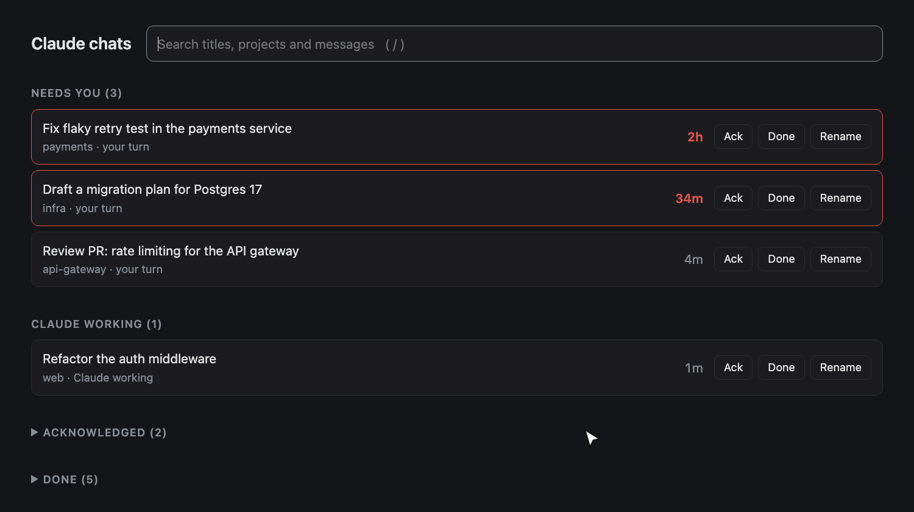

# claude-tracker

Lists your Claude Code chats and pings you about the ones you left hanging.



## Install

macOS only. Needs `python3`, `jq` and `terminal-notifier` (`brew install terminal-notifier`).

```
./install.sh
```

Then turn on notifications for terminal-notifier in System Settings > Notifications, or pings fail silently. Open http://127.0.0.1:7878 and keep it pinned. `./uninstall.sh` removes everything except your data.

## How to use it

A chat shows up under "Needs you" once Claude answers, and stays there until you decide what to do with it:

- Finished with it? Type `/done` in the chat, or click Done.
- Read the answer but have nothing to do right now? Type `/ack`, or click Ack. It leaves the list until you message it again.
- Need to reply? Just reply. It moves to "Claude working" until Claude answers.

A chat left under "Needs you" for 20 minutes turns red and you get a notification. When one arrives, go through the red rows and give each a reply, an `/ack` or a `/done`.

Click a title to jump to the chat's VS Code tab.

`/done` and `/ack` never reach Claude, so they cost no tokens.

## Search

Press `/` and type. Search covers every chat, including acked and finished ones, and looks at titles, project folders, your prompts and Claude's replies. Words match anywhere, even inside other words, and a chat has to match every word you type. Each result shows the line that matched.

## Details

- Pings: one per quiet stretch. Clicking it opens the chat, or this page if several are waiting. A chat where it's Claude's turn but nothing has happened for an hour also pings, since it's usually stuck or was interrupted.
- Renames: Rename in the UI changes the name only in the tracker. A rename in VS Code ("Rename Session Tab") shows up within a minute and replaces it.
- `/clear` marks the cleared chat done. Headless `claude -p` runs are ignored.
- Data lives in `~/.claude/tracker`: `tracker.db`, `errors.log`, and `server.log` from launchd.

## License

Apache License 2.0. See LICENSE.
